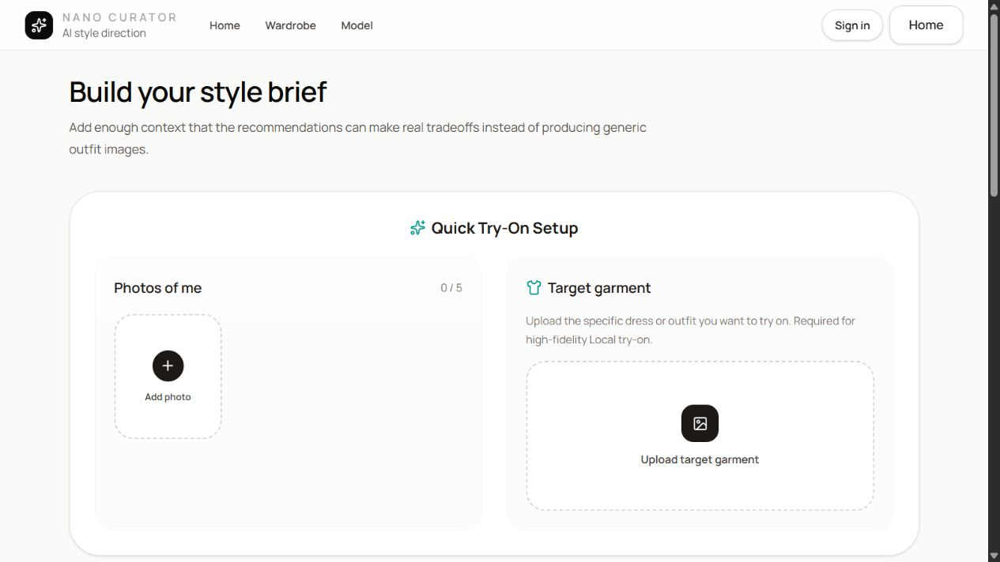
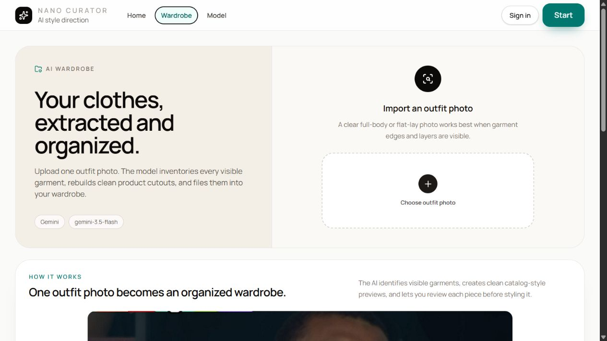
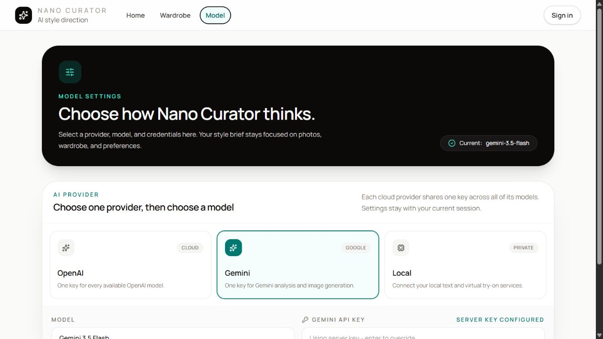

# Nano Curator

Nano Curator is an AI-powered personal stylist. It turns your photos, wardrobe, occasion, budget, climate, and style preferences into complete outfit directions, haircut suggestions, shopping ideas, and a sustainable fashion report.


## How it works

1. **Choose an AI model.** Open **Model settings** and select Gemini, OpenAI, OpenRouter, Meta, or private local text and virtual try-on services. Cloud credentials can come from the server or be entered for the current browser tab.
2. **Build a style brief.** Add up to five photos, an optional target garment or inspiration image, and any wardrobe pieces you want the recommendations to reuse. Then describe the occasion, goal, budget, climate, dress code, color preferences, and comfort constraints.
3. **Generate a collection.** Nano Curator creates three distinct looks, highlights the best fit, recommends wardrobe reuse, and can include haircut direction, purchasable products, lower-cost alternatives, and sustainability guidance.
4. **Keep building your wardrobe.** Import an outfit photo to identify its visible garments and create organized, catalog-style wardrobe pieces for future styling sessions. Completed sessions are also available from the home screen.

### Build the style brief

The main workflow keeps photos, wardrobe selection, output options, and practical constraints together in one brief.



### Organize an AI wardrobe

The wardrobe workspace extracts individual pieces from a clear outfit or flat-lay photo, lets you review them by category, and makes them available to future briefs. Open **See an extraction example** to compare a source outfit with individual pieces, using touch or keyboard as well as a mouse.



#### One outfit photo, organized wardrobe pieces

Source outfit:


The in-app example shows the individual pieces alongside the source photo:


### Choose where the AI runs

Cloud providers include preset models and accept a custom model ID. API keys entered in the app remain in memory for the current browser tab and are separate from saved style sessions.



### Extract and shop with Meta SAM 3.1

Set `META_API_KEY` in `.env.local` and restart the server. Meta offers Muse Spark, Muse Wonder, and Muse Ember for style analysis and uses Muse Image for previews. You can use SAM in **Wardrobe** with any style provider selected.

Choose **Meta SAM 3.1** as the extraction method and upload an outfit photo. To isolate a specific piece, enter a short description such as `dress` or `burgundy wrap dress` in **Garment to isolate**. Muse identifies visible details and SAM masks the original photo to create a transparent cutout. Repeat for each outfit photo you want to add.

**Enhance previews with Muse Image** saves a sharper catalog preview alongside each SAM cutout. The cutout appears first while the image edit runs. Use **Show SAM cutout** to compare it with the enhanced preview, or **Enhance preview** on a SAM piece saved before this option was added. Product search uses the original cutout.

Use **Find similar** on a piece to search from its cutout and an editable description. Meta search works with the same key and returns grounded retailer links when available. The **Google Shopping** link uses the description alone. For direct Google Lens reverse-image search, configure both `IMGBB_API_KEY` and `SERPAPI_API_KEY`. Lens uses a publicly hosted copy of the cutout. Check retailer pages for current prices and availability.

In style collection results, **Shop this look → Find real products** uses the same Meta key to search from the look preview and its description. If no Meta key is configured, the button uses Google Lens when both Lens credentials are set.

## Run locally

Requirements: Node.js 22.12 or newer on an active LTS release.

```bash
npm install
npm run dev
```

Open [http://localhost:3000](http://localhost:3000).

Copy `.env.example` to `.env.local` and configure the providers you want to use:

```bash
GEMINI_API_KEY=...
OPENAI_API_KEY=...
OPENROUTER_API_KEY=...
META_API_KEY=...

# Optional for Google Lens reverse-image search
IMGBB_API_KEY=...
SERPAPI_API_KEY=...

# Optional private local services
LLM_API_URL=http://localhost:11434/v1
LLM_MODEL=gemma4:e4b
VTON_API_URL=http://127.0.0.1:7860
```

If a cloud key is not configured on the server, the app asks for it after the user selects that provider.

## Authentication

Email magic-link, Google OAuth, and guest-mode setup are documented in [AUTH_SETUP.md](./AUTH_SETUP.md).
