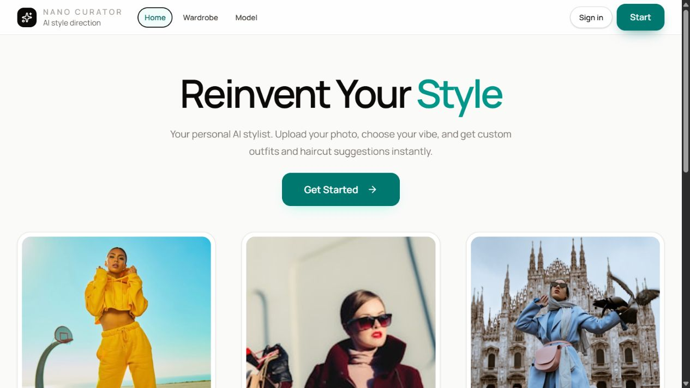
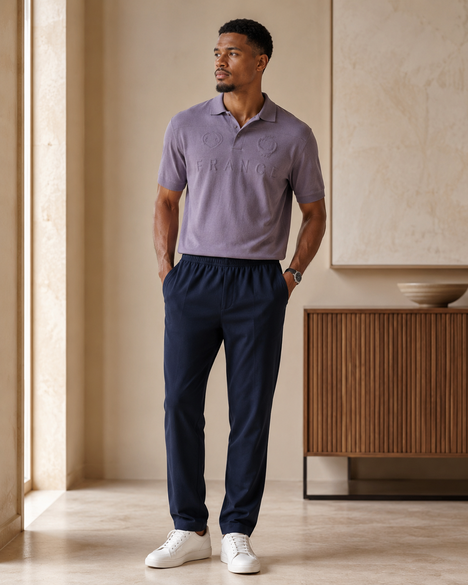
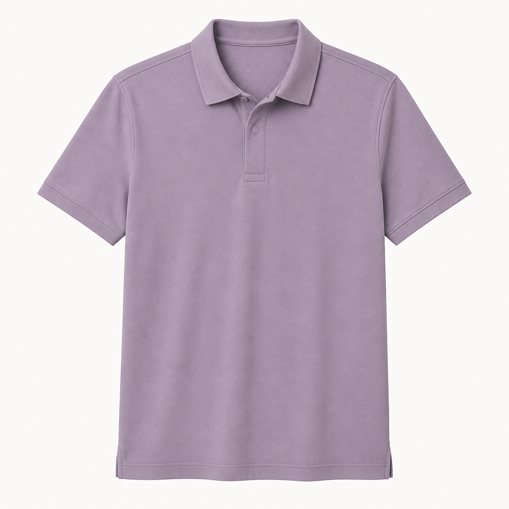
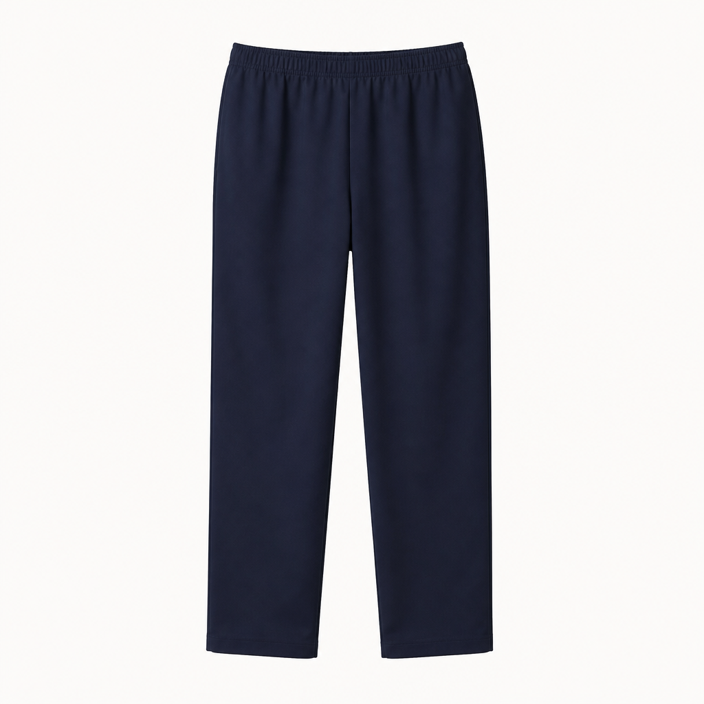
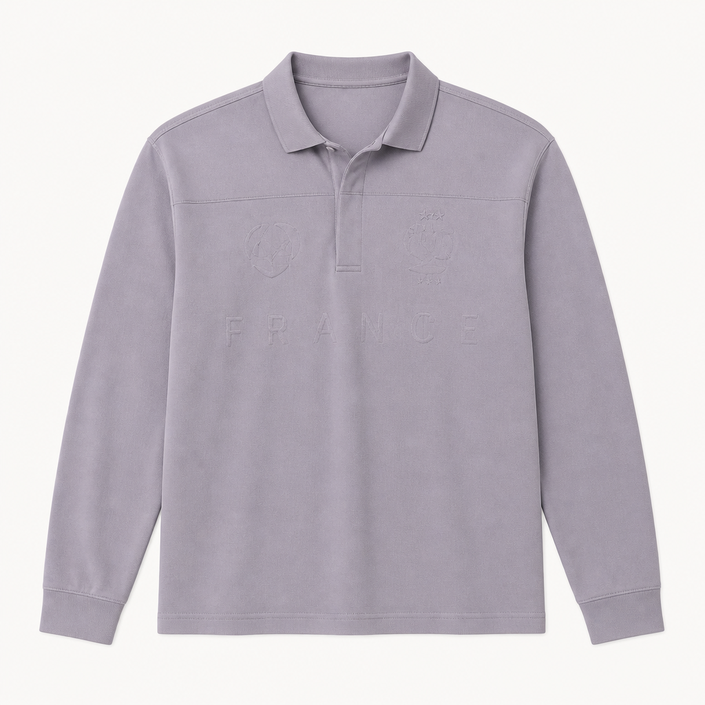
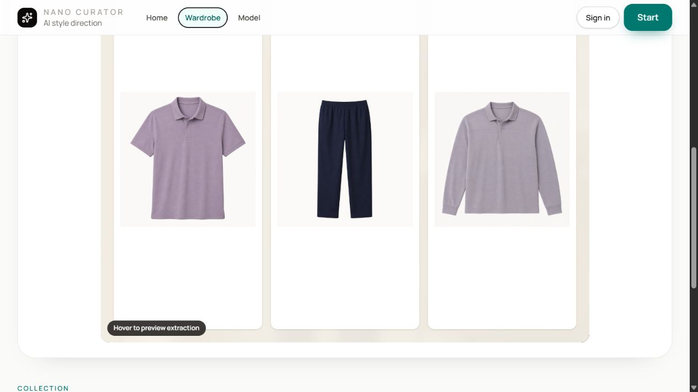

# Nano Curator

Nano Curator is an AI-powered personal stylist. It turns your photos, wardrobe, occasion, budget, climate, and style preferences into complete outfit directions, haircut suggestions, shopping ideas, and a sustainable fashion report.



## How it works

1. **Choose an AI model.** Open **Model** and select OpenAI, Gemini, or private local text and virtual try-on services. Cloud credentials can come from the server or be entered for the current browser tab.
2. **Build a style brief.** Add up to five photos, an optional target garment or inspiration image, and any wardrobe pieces you want the recommendations to reuse. Then describe the occasion, goal, budget, climate, dress code, color preferences, and comfort constraints.
3. **Generate a collection.** Nano Curator creates three distinct looks, highlights the best fit, recommends wardrobe reuse, and can include haircut direction, purchasable products, lower-cost alternatives, and sustainability guidance.
4. **Keep building your wardrobe.** Import an outfit photo to identify its visible garments and create organized, catalog-style wardrobe pieces for future styling sessions. Completed sessions are also available from the home screen.

### Build the style brief

The main workflow keeps photos, wardrobe selection, output options, and practical constraints together in one brief.


### Organize an AI wardrobe

The wardrobe workspace extracts individual pieces from a clear outfit or flat-lay photo, lets you review them by category, and makes them available to future briefs. The demo below uses the full-body outfit photo in `public/examples/wardrobe/source-outfit.png`; hover the “How it works” image in the app to preview the catalog-style garment cutouts.


#### One outfit photo, organized wardrobe pieces

Source outfit:



Catalog previews shown by the wardrobe extraction demo:





The in-app hover preview brings those pieces forward as a reviewable wardrobe set:



### Choose where the AI runs

Model settings support OpenAI, Google Gemini, and private local services. API keys entered in the app remain in memory for the current browser tab and are not saved with style sessions.


## Run locally

Requirements: Node.js 18 or newer.

```bash
npm install
npm run dev
```

Open [http://localhost:3000](http://localhost:3000).

Copy `.env.example` to `.env.local` and configure the providers you want to use:

```bash
GEMINI_API_KEY=...
OPENAI_API_KEY=...

# Optional private local services
LLM_API_URL=http://localhost:11434/v1
LLM_MODEL=gemma4:e4b
VTON_API_URL=http://127.0.0.1:7860
```

If a cloud key is not configured on the server, the app asks for it after the user selects that provider.

## Authentication

Email magic-link, Google OAuth, and guest-mode setup are documented in [AUTH_SETUP.md](./AUTH_SETUP.md).
